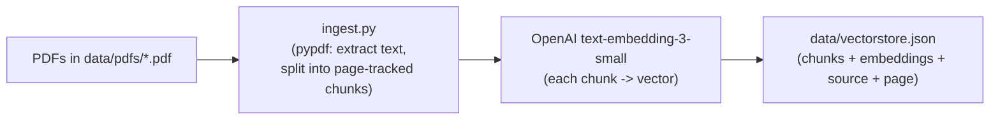
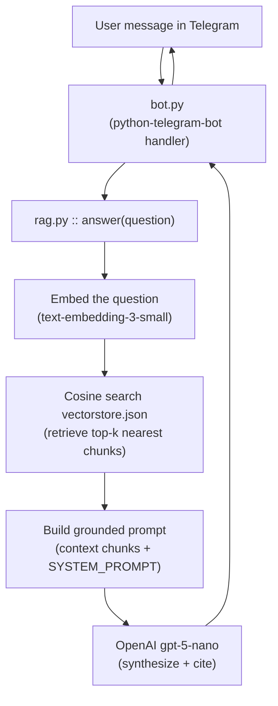
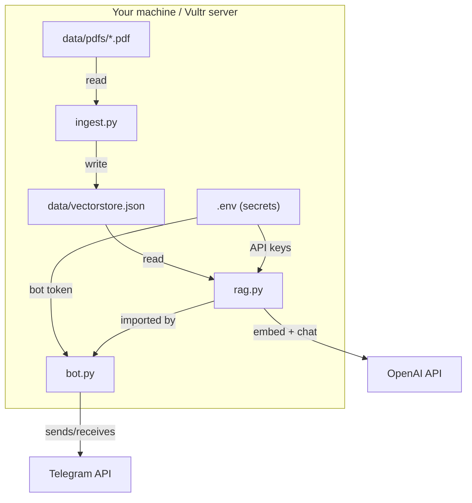

# MAS AI Risk Q&A Bot

> A Retrieval-Augmented Generation (RAG) chatbot that answers questions about **AI risk
> management in financial services**, grounded entirely in **MAS (Monetary Authority of
> Singapore)** materials. You chat with it in **Telegram**; it retrieves the relevant
> passages from the MAS corpus, answers **only from those passages**, and cites the source
> document + page number for every claim.

This bot exists to make Singapore's evolving AI-risk rulebook *askable*. Instead of reading
hundreds of pages, a banker, risk officer, or compliance lead can type a plain-English
question and get a concise, sourced answer drawn from the MAS Guidelines on AI Risk
Management and the Project MindForge handbooks.

---

## Table of contents

- [What is this bot?](#what-is-this-bot)
- [What is on MAS's mind on AI risk?](#what-is-on-mass-mind-on-ai-risk)
- [The corpus (what the bot reads)](#the-corpus-what-the-bot-reads)
- [Architecture & data flow](#architecture--data-flow)
- [How a question travels end to end](#how-a-question-travels-end-to-end)
- [Project structure](#project-structure)
- [Setup (local)](#setup-local)
- [Run](#run)
- [Deploy to Vultr (24/7)](#deploy-to-vultr-247)
- [How the bot answers (prompt behaviour)](#how-the-bot-answers-prompt-behaviour)
- [Privacy & citations](#privacy--citations)
- [Limitations](#limitations)

---

## What is this bot?

It is a **domain-specific Q&A assistant**, not a general chatbot. Three things define it:

1. **Grounded, not creative.** Every answer is built from retrieved text. If the MAS
   corpus doesn't cover the question, the bot says so plainly instead of guessing.
2. **Cited.** Each claim carries a `(Document, p. N)` citation so a user can verify against
   the original MAS publication.
3. **Concise and mobile-first.** Answers are 2–4 short paragraphs; a help message is
   formatted to read cleanly on a phone screen.

The retrieval engine is a lightweight local vector store (JSON + numpy cosine similarity).
The corpus is tiny (three PDFs), so a full database is unnecessary — the index builds in
seconds and runs anywhere, including a small Vultr VPS.

---

## What is on MAS's mind on AI risk?

Understanding *why this bot's corpus looks the way it does* helps you use it. MAS's thinking
on AI risk has developed in clear stages, and the three PDFs in this repo map directly onto
that journey.

### The big picture

MAS has deliberately chosen a **proportionate, outcomes-based, technology-neutral** approach.
Rather than a rigid, prescriptive rulebook (the EU AI Act model), MAS sets *expectations* and
lets each financial institution (FI) scale its controls to the **size, nature, and risk
materiality** of its AI use. The through-line is that AI governance should fold into existing
risk frameworks — boards and senior management own it, and accountability never dissolves
into the model.

### 1. FEAT Principles (2018) — the foundation

MAS co-created the **FEAT Principles** with industry to promote responsible use of AI and
Data Analytics (AIDA) in finance:

- **Fairness** — AI adoption must not treat customers less favourably than the business.
- **Ethics** — use AI in an ethical, socially beneficial way.
- **Accountability** — firms remain accountable for AI-driven outcomes.
- **Transparency** — give customers transparent disclosure to enable informed decisions.

FEAT is the bedrock; everything below operationalises it.

### 2. Veritas Initiative (2019) — making FEAT measurable

A MAS-led industry consortium built the **Veritas Initiative** to turn FEAT from aspiration
into assessment — a methodology, a toolkit, and case studies FIs can use to test real AI
solutions against the principles.

### 3. Project MindForge (2023–2025) — Generative & Agentic AI

As Generative AI arrived, **Project MindForge** (also driven by Veritas) examined its risks:

- **Phase 1 (whitepaper, May 2024)** produced the first financial-industry taxonomy of Gen AI
  risks and confirmed FEAT/Veritas still apply, with added considerations.
- **Phase 2** delivered the two handbooks in this repo — the **Executive Handbook** (for
  governing AI) and the **Operationalisation Handbook** (detailed implementation practices).
  Together with an *Implementation Examples* volume, they form the **MindForge AI Risk
  Management Handbook**, intended to support the proposed MAS Guidelines.

### 4. AI Model Risk Management Information Paper (Dec 2024)

After a thematic review of banks' AI practices, MAS published good practices across three
areas: **governance & oversight**, **AI identification / inventory / materiality assessment**,
and **development, validation, deployment, monitoring & change management** — plus dedicated
sections on **Generative AI** (hallucination is a key concern; banks limited Gen AI mostly to
human-assisting, non-customer-facing uses) and **third-party AI**.

### 5. Guidelines on AI Risk Management (issued October 2026)

This is the headline document in the corpus. MAS issued its **Guidelines on Artificial
Intelligence Risk Management**, setting supervisory expectations around four pillars:

1. **Oversight & accountability** — boards and senior management own AI risk; clear roles,
   risk appetite, and policies. (No separate AI committee required if existing governance
   already gives adequate oversight.)
2. **AI risk management system** — a live **inventory** of every AI use case and
   **materiality assessments** scored on *impact, complexity, and reliance*.
3. **Lifecycle controls** — data governance, testing, human oversight, cybersecurity,
   monitoring, and change management across development, deployment, and maintenance.
4. **Capabilities & capacity** — skilled staff and resilient infrastructure to run AI safely.

The Guidelines are **proportionate** (obligations scale with AI use), reach **Generative AI**
and **Agentic AI**, and (per the corpus) take effect **7 October 2027** with phased
implementation allowed until **7 October 2028**.

### 6. Toolkit & Agentic AI (2026)

MAS also released an **AI Risk Management Toolkit** (developed with 24 institutions) and, with
industry, the **SAFR** framework (*Safeguards for Agentic Finance at Runtime*) focused on how
agent actions are authorised, assessed, and recorded at execution time. Agentic AI — systems
that can *act*, not just generate — is the frontier MAS is actively watching.

### Key themes a user will see repeated in answers

| Theme | What MAS expects |
|-------|------------------|
| Governance | Board/senior-management ownership; cross-functional oversight forums |
| Inventory | A central, maintained record of every AI use case |
| Materiality | Assess by impact, complexity, and reliance (autonomy) |
| Lifecycle | Controls across build, deploy, monitor, change |
| Third-party AI | FI retains ultimate responsibility; get assurance, test, compensate |
| Human oversight | Keep a human in the loop for material decisions |
| Fairness & explainability | Mitigate bias; be able to explain and audit decisions |

This bot answers questions *about these expectations* using the source texts.

---

## The corpus (what the bot reads)

Stored in `data/pdfs/` (git-ignored — they are not committed to GitHub).

| File | MAS origin | Role in answers |
|------|-----------|-----------------|
| `Guidelines on Artificial Intelligence Risk Management.pdf` | MAS Guidelines (Oct 2026) | The definitive supervisory expectations (4 pillars, effective dates, proportionality) |
| `MindForge AI Risk Management Executive Handbook.pdf` | Project MindForge Phase 2 | Governance considerations & implementation practices for executives |
| `MindForge AI Risk Management Operationalisation Handbook.pdf` | Project MindForge Phase 2 | Detailed operationalisation, illustrations, appendices |

> The bot only "knows" what is inside these three files. Add or swap PDFs, then re-run
> `ingest.py` to rebuild the index.

---

## Architecture & data flow

There are two pipelines: **ingestion** (one-off, rerun when PDFs change) and **query**
(runs on every Telegram message).

### Diagram 1 — Ingestion (build the knowledge index)



Plain version:

```
PDFs (data/pdfs/*.pdf)
   |
   v
ingest.py   -- pypdf extracts text, splits into chunks, each chunk tagged with source + page
   |
   v
OpenAI text-embedding-3-small   -- turns each chunk into a numeric vector (embedding)
   |
   v
data/vectorstore.json   -- stores every chunk, its embedding, source file, and page number
```

### Diagram 2 — Query (answer a Telegram question)



Plain version:

```
User message (Telegram)
   |
   v
bot.py  (receives the update, calls rag.answer)
   |
   v
rag.py:
   1. embed the question
   2. cosine-search vectorstore.json for the top-k relevant chunks
   3. assemble a prompt: retrieved context + the answer rules
   4. call OpenAI gpt-5-nano -> answer with (Document, p. N) citations
   |
   v
bot.py sends the answer back to Telegram
```

### Diagram 3 — How the files relate to each other and to the artifacts



File-by-file responsibility:

| File | Reads | Writes / Calls | Purpose |
|------|-------|----------------|---------|
| `ingest.py` | `data/pdfs/*.pdf` | `data/vectorstore.json` | Build the index from PDFs |
| `rag.py` | `data/vectorstore.json` | OpenAI API | Retrieve + answer with citations |
| `bot.py` | `rag.answer()` | Telegram API | 24/7 chat interface |
| `.env` | — | secrets | `OPENAI_API_KEY` + `TELEGRAM_BOT_TOKEN` |
| `deploy/ragbot.service` | — | systemd unit | Keep the bot alive on the server |

---

## How a question travels end to end

1. You message the bot in Telegram (e.g. *"What does MAS expect for third-party AI?"*).
2. `bot.py` receives the update and forwards the text to `rag.answer()`.
3. `rag.py` embeds your question and finds the most similar chunks in `vectorstore.json`
   (cosine similarity, top-k).
4. Those chunks become the **context**, wrapped with the answer rules (the system prompt).
5. `gpt-5-nano` synthesizes a concise answer and attaches `(Document, p. N)` citations.
6. `bot.py` posts the reply back to your Telegram chat.
7. If your message is a greeting or "help", the bot returns a short usage guide instead.

---

## Project structure

```
ai-risk-qa-bot/
├── README.md                  # this file
├── requirements.txt           # python-telegram-bot, openai, pypdf, numpy, python-dotenv
├── .env.example               # template for secrets
├── .gitignore                 # keeps PDFs, .env, vectorstore.json out of git
├── ingest.py                  # PDFs -> chunks -> embeddings -> vectorstore.json
├── rag.py                     # retrieval + grounded prompt + gpt-5-nano answer
├── bot.py                     # Telegram listener (24/7)
├── data/
│   ├── pdfs/                  # <-- the 3 MAS source PDFs (git-ignored)
│   └── vectorstore.json       # generated index (git-ignored)
└── deploy/
    └── ragbot.service         # systemd unit for Vultr
```

---

## Setup (local)

```bash
python -m venv .venv && source .venv/bin/activate
pip install -r requirements.txt
cp .env.example .env          # fill in TELEGRAM_BOT_TOKEN + OPENAI_API_KEY
python ingest.py             # PDFs -> data/vectorstore.json (run whenever PDFs change)
```

---

## Run

```bash
python rag.py "What are MAS's expectations for third-party AI risk?"   # test retrieval + answer
python bot.py                   # start the Telegram listener (Ctrl+C to stop)
```

Message the bot in Telegram to use it. The old Planner bot (if any) is unaffected — each bot
has its own token.

---

## Deploy to Vultr (24/7)

See `ai-risk-qa-bot-implementation-guide.md` (full build) and
`ai-risk-qa-bot-deploy-guide.md` (ops-only steps): push to GitHub, clone on the server,
`pip install`, upload the PDFs, `python ingest.py`, then install `deploy/ragbot.service` via
systemd so the bot auto-restarts on crash or reboot.

---

## How the bot answers (prompt behaviour)

The `SYSTEM_PROMPT` in `rag.py` instructs the model to:

- Write in its **own words** — no long verbatim copying.
- Keep **quotes short** (under 15 words), only when exact wording matters.
- **Cite** the source document and page after each claim, e.g.
  `(MindForge Executive Handbook, p. 12)`.
- Say **plainly** when the context doesn't cover the question.
- Prefer **2–4 short paragraphs**; be concise.
- **Note disagreements** between sources.

If the question is a greeting or a request for help, the bot returns a short, phone-friendly
usage guide instead of attempting an answer.

---

## Privacy & citations

- PDFs and `vectorstore.json` live **only** on your machine / server and are git-ignored.
- Only code and `.env.example` are committed to GitHub — your key and corpus never leave your
  control.
- Each answer cites the exact MAS document and page so claims are verifiable.

---

## Limitations

- The bot answers **only** from the three PDFs. It does not browse the live MAS website or
  other sources, and it cannot give legal advice.
- Embeddings and answers call the OpenAI API, so the server needs outbound internet and a
  valid key.
- Re-run `ingest.py` after adding or changing PDFs; the index is not auto-refreshed.
- Dates/effective timelines reflect the corpus as provided; always confirm against the latest
  MAS publication before relying on them for compliance.
